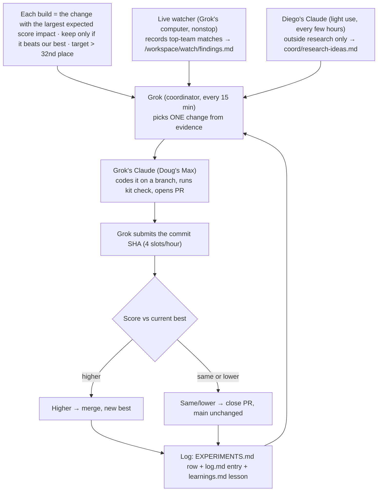

# Workflow (source of truth from Fri 22:45 ET, Nov 20)

**The one goal (updated Fri 23:47 ET by Doug):** each build is the system change with the LARGEST expected impact on total score, not a small tweak. Rank candidates by expected score gain (winner-vs-loser gap size × how many matches it affects × evidence confidence ÷ cost and risk), and build the top one. Prefer changes that close a big structural gap (e.g. a whole missing system such as cube economy or engagement decisions) over parameter nudges. Promotion rule unchanged: keep only if it beats the current best. **Kills are the score (Sat 00:20 ET):** practice house bots never kill each other (track rules), so places come only from house bots dying to us or the zone; aim every build at more kills/damage. **Throughput (Sat 00:20 ET, Doug):** two build lanes run in parallel to fill all 4 slots/hour; a local sim (tools/sim, PR pending) pre-screens builds once calibrated; Diego loop every 20 min. Targets: above 32nd place (about 4.25) by Sun 11:00 AM ET; long-run 6.00.

## Who does what
| Who | Does | Never |
|---|---|---|
| Grok (coordinator) | picks the next change, submits, scores, merges or closes, logs | writes bot code itself |
| Grok's Claude (Doug's Max) | the only code writer: one change per branch, check must pass | merges, submits |
| Diego's Claude (light) | outside research: top teams' public repos, protocol details → ranked ideas with evidence | writes bot code, edits main bot files |
| Doug's own Claude | stopped (handoff in `coord/handoff-doug-claude.md`) | — |
| Doug / Diego | set direction, approve big pivots | — |

## Rules
- Practice is deterministic (fixed seeds): judge by the raw delta vs the current best. Higher = keep and merge. Same or lower = close.
- One change per submission, always branched off current main (the best build).
- Don't resubmit a scored commit. Never click "Pick as our final entry" (best score is used automatically).
- Guard against overfitting: the final uses new seeds, so prefer changes with a clear mechanism.
- Hard caps H1–H3 stay.

## Cut (no longer used)
- `next-doug.md` / per-person prompts for coding, the §4 file-ownership split, the −0.6/+1.2 noise band, repeating the log in PR descriptions.
- Kept: `coord/log.md`, `EXPERIMENTS.md`, `coord/learnings.md`, this file.

## Pipeline (from Fri 23:15 ET)
Structured memory lives in `pipeline/` (see `pipeline/README.md`). Grok runs `python3 pipeline/q.py brief` each tick, picks one hypothesis, sends `q.py task HYP-x` to Claude, and records kit check, Codex review, submission, score and promotion with `q.py`. Diego hands in research as JSON in `research/intake/` (`research/intake/README.md`). `EXPERIMENTS.md`, `coord/log.md` and `coord/learnings.md` stay as the human-readable record. Goal unchanged: every submission beats the champion; long-run target 6.00.
