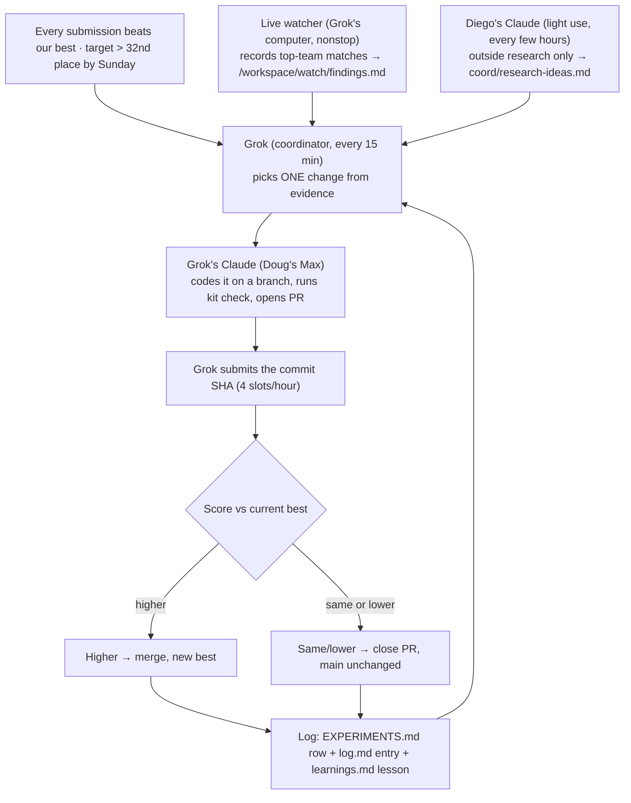

# Workflow (source of truth from Fri 22:45 ET, Nov 20)

**The one goal:** every practice submission must beat our current best score. Target: above 32nd place (4.17 at 22:39 ET) by Sunday. Anything that does not raise damage dealt or survival time is deprioritized.

## Who does what
| Who | Does | Never |
|---|---|---|
| Grok (coordinator) | picks the next change, submits, scores, merges or closes, logs | writes bot code itself |
| Grok's Claude (Doug's Max) | the only code writer: one change per branch, check must pass | merges, submits |
| Diego's Claude (light) | outside research: top teams' public repos, protocol details → ranked ideas with evidence | writes bot code, edits main bot files |
| Doug's own Claude | stopped (handoff in `coord/handoff-doug-claude.md`) | — |
| Doug / Diego | set direction, approve big pivots | — |

## Rules
- Practice is deterministic (fixed seeds): judge by the raw delta vs the current best. Higher = keep and merge. Same or lower = close.
- One change per submission, always branched off current main (the best build).
- Don't resubmit a scored commit. Never click "Pick as our final entry" (best score is used automatically).
- Guard against overfitting: the final uses new seeds, so prefer changes with a clear mechanism.
- Hard caps H1–H3 stay.

## Cut (no longer used)
- `next-doug.md` / per-person prompts for coding, the §4 file-ownership split, the −0.6/+1.2 noise band, repeating the log in PR descriptions.
- Kept: `coord/log.md`, `EXPERIMENTS.md`, `coord/learnings.md`, this file.
