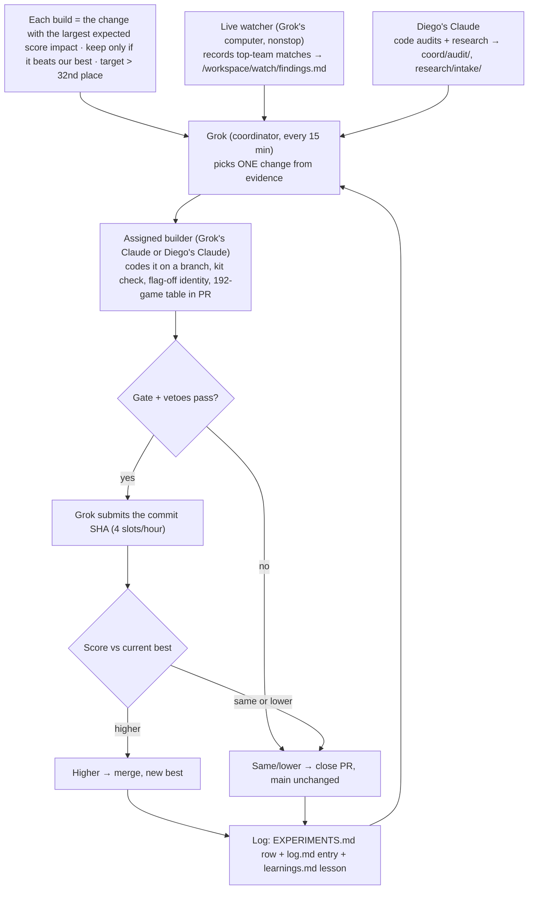

# Workflow (source of truth from Fri 22:45 ET, Nov 20)

> **OPEN DIRECTIVE (Sat Nov 21, 11:18 AM ET, from Diego, highest priority):** read [`coord/DIRECTIVE-2026-11-21-master-audit.md`](DIRECTIVE-2026-11-21-master-audit.md) first and answer its §18. Today's audits are in `coord/audit/`; don't redo them.

**The one goal (updated Fri 23:47 ET by Doug):** each build is the system change with the LARGEST expected impact on total score, not a small tweak. Rank candidates by expected score gain (winner-vs-loser gap size × how many matches it affects × evidence confidence ÷ cost and risk), and build the top one. Prefer changes that close a big structural gap (e.g. a whole missing system such as cube economy or engagement decisions) over parameter nudges. Promotion rule unchanged: keep only if it beats the current best. **Kills are the score (Sat 00:20 ET):** practice house bots never kill each other (track rules), so places come only from house bots dying to us or the zone; aim every build at more kills/damage. **Throughput (Sat 00:20 ET, Doug):** two build lanes run in parallel to fill all 4 slots/hour; a local sim (tools/sim, PR pending) pre-screens builds once calibrated; Diego loop every 20 min. Targets: above 32nd place (about 4.25) by Sun 11:00 AM ET; long-run 6.00.

**Lane split (Sat 00:50 ET, Doug):** the two lanes own separate parts of the bot so one lane's keep never goes stale under the other.
- **Lane A: movement.** Pathing, positioning, spacing, zone, sneak/stealth, retreat. Mainly `nav.ts`, `map.ts`, and the movement parts of `brain.ts`.
- **Lane B: combat.** Target choice, aim, firing, weapons and laser use, upgrades. Mainly `target.ts` and the fire/weapon parts of `brain.ts`.
- Each new lane build starts from the latest `main` (the current champion). A lane never edits the other lane's files. A `brain.ts` change stays in its own lane's functions; anything that crosses lanes gets flagged to Grok before it's built.
- After any keep, the open build in the other lane rebases onto the new main and re-runs the gate before submission. Because the files don't overlap, this should be a clean rebase.
- Builds already in flight at the switch (B17 laser in B, B19 no-sneak in A) finish as they are. They already fit this split.

## Who does what
| Who | Does | Never |
|---|---|---|
| Grok (coordinator) | picks the next change, submits, scores, merges or closes, logs | writes bot code itself |
| Grok's Claude (Doug's Max) | builds assigned changes: one change per branch, check must pass | merges, submits |
| Diego's Claude | code audits, research, AND bot code (Doug approved Sat 12:14 PM ET): edits `*.ts` only for the change Grok assigns in `coord/next-diego.md`, on its own branch, one flag with flag 0 = champion byte-identical | merges, submits, pushes to main, touches files or logic another builder is assigned (lightning/H1 is Doug's Claude's now) |
| Doug's own Claude | stopped (handoff in `coord/handoff-doug-claude.md`) | — |
| Doug / Diego | set direction, approve big pivots | — |

## Rules
- Practice is deterministic (fixed seeds): judge by the raw delta vs the current best. Higher = keep and merge. Same or lower = close. See Slot rules below for what earns a slot.
- One change per submission, always branched off current main (the best build).
- Don't resubmit a scored commit. Never click "Pick as our final entry" (best score is used automatically).
- Guard against overfitting: the final uses new seeds, so prefer changes with a clear mechanism.
- Hard caps H1–H3 stay.

## Slot rules (Sat Nov 21, 11:50 AM ET; from Diego's audit `coord/audit/perf-fix-handoff-2026-11-21-1115.md` §3, §4, §7)
1. **One builder per change.** Grok assigns it in `coord/log.md` before anyone codes. A second thread on the same idea stops.
2. **No slot without the table.** The PR body must show, for the 192 paired games (SEED_BASE 2000 + 3000) vs the champion: sim Δ ± SE, games changed (better/worse), **kills and kills per minute after 60 s (primary: in practice score ≈ our kills, r 0.989)**, laser by 30 s, died before 40 s, gun-only at end, lightning at end, 2+ attackers at death, stuck, and decision p99/max. Grok re-runs or spot-checks it.
3. **Pre-slot gate.** `check.py --map-dir arena` PASS with max under 30 ms. Any new flag set to 0 must match the champion's actions exactly (0 games changed).
4. **Vetoes (no slot if any trips).** Died before 40 s up by more than 3/192, or lightning at end down by more than 5. (The sim Δ −0.3 veto is retired Sat 12:35 PM ET: it caught 0 of 10 real site drops.)
0. **Real site score is the only source of truth (Doug, Sat 12:32 PM ET).** Keep/close is decided only by the official site score strictly beating the verified champion. The sim is a screen for crashes, timing (check.py), flag-0 byte-identity and gross vetoes; it never ranks builds or justifies a keep.
Every official site submission and local screen must be recorded in [`coord/data/`](data/README.md) (`site_results.csv`, `screens.csv`, `ideas.md`). That directory is the required record; the site score remains the only keep/close truth.
5. **The sim screens; it doesn't predict.** Sim score vs site has r = 0.22 over 28 builds (`coord/research/site-corr-2026-11-21.txt`). Rank candidates by kills first, then the other behavior metrics in rule 2 and the mechanism, not by sim Δ alone. Lightning at end stays a veto but is a proxy, not a ranking metric (Diego state report d). Every screen also runs held-out SEED_BASE 4000+5000.
6. **No rematches or near-copies.** Old open PRs and builds that change fewer than about 10 of 192 games don't get slots (B26 3.48, B51 3.79 tie, B94 6/192 → 3.73).
7. **Keep rule.** Keep only if strictly above the current best. A tie keeps the old champion (the earlier submission holds the final entry).
8. **One follow-up per idea.** If a change ties, it gets at most one variant (for UF100, `UNDER_FIRE_RUSH_M = 80`). No third variant.
9. **Re-measure after every keep.** Re-run Diego's death and opening instrumentation on the new champion before picking the next fix. Current queue: UF100 (PR #88), then the early heal-under-fire walk to cover (re-measure first), then park `ourMagazine`. Dropped: new positioning or cover search, readiness-aware combat estimates, and nav detour patches.
10. **Lock.** Final build locked by Sun 9:00 AM ET on the best verified site score. After that, no merges to main.

## Cut (no longer used)
- `next-doug.md` (per-person coding prompts for Doug's Claude; `next-diego.md` is back as Grok's prompt inbox for Diego's Claude, Sat 12:12 PM ET), the §4 file-ownership split, the −0.6/+1.2 noise band, repeating the log in PR descriptions.
- Kept: `coord/log.md`, `EXPERIMENTS.md`, `coord/learnings.md`, this file.

## Pipeline (from Fri 23:15 ET)
Structured memory lives in `pipeline/` (see `pipeline/README.md`). Grok runs `python3 pipeline/q.py brief` each tick, picks one hypothesis, sends `q.py task HYP-x` to Claude, and records kit check, Codex review, submission, score and promotion with `q.py`. Diego hands in research as JSON in `research/intake/` (`research/intake/README.md`). `EXPERIMENTS.md`, `coord/log.md` and `coord/learnings.md` stay as the human-readable record. Goal unchanged: every submission beats the champion; long-run target 6.00.

## Sequence rule (Doug, Sat Nov 21 1:09 PM ET)
Never submit a build while an earlier submission is still unscored. Wait for the score. If it is a new best, merge it, then rebase every queued build onto the new main and re-gate before it is submitted. Every submitted build's parent must be the current champion; a build tested on an old base is a wasted test.
