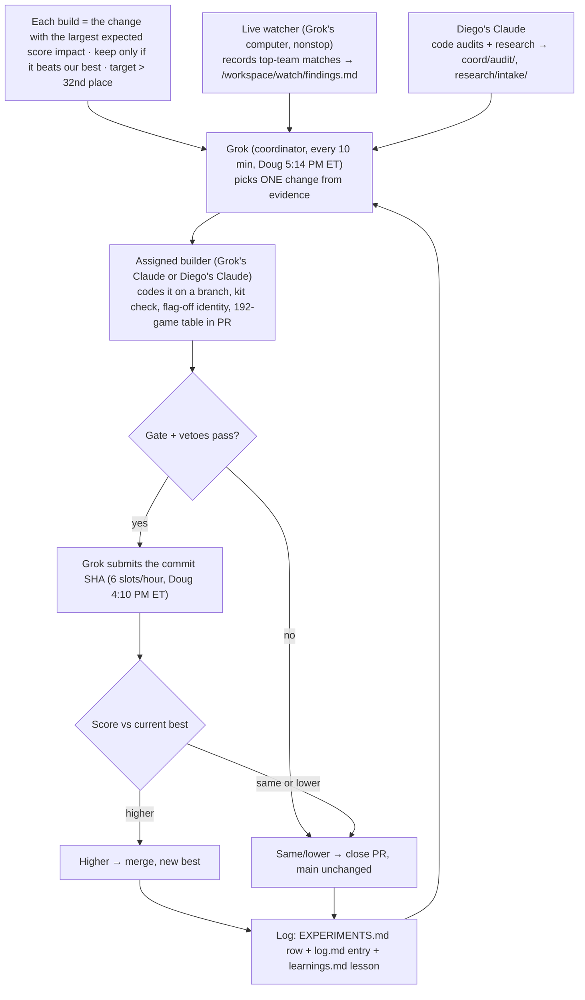

> The official process is coord/WORKFLOW_CHART.md, LOCKED by Doug Sat Nov 21 3:09 PM ET. Changes need Doug's explicit yes.

# Workflow (source of truth from Fri 22:45 ET, Nov 20)

> **OPEN DIRECTIVE (Sat Nov 21, 11:18 AM ET, from Diego, highest priority):** read [`coord/DIRECTIVE-2026-11-21-master-audit.md`](DIRECTIVE-2026-11-21-master-audit.md) first and answer its §18. Today's audits are in `coord/audit/`; don't redo them.

**The one goal (updated Fri 23:47 ET by Doug):** each build is the system change with the LARGEST expected impact on total score, not a small tweak. Rank candidates by expected score gain (winner-vs-loser gap size × how many matches it affects × evidence confidence ÷ cost and risk), and build the top one. Prefer changes that close a big structural gap (e.g. a whole missing system such as cube economy or engagement decisions) over parameter nudges. Promotion rule unchanged: keep only if it beats the current best. **Kills are the score (Sat 00:20 ET):** practice house bots never kill each other (track rules), so places come only from house bots dying to us or the zone; aim every build at more kills/damage. **Throughput (Sat 00:20 ET, Doug):** two build lanes run in parallel to fill all 6 slots/hour (4 until Sat 4:10 PM ET; Doug confirmed 6); a local sim (tools/sim, PR pending) pre-screens builds once calibrated; Diego loop every 20 min. Targets: above 32nd place (about 4.25) by Sun 11:00 AM ET; long-run 6.00.

**Lane split (Sat 00:50 ET, Doug):** the two lanes own separate parts of the bot so one lane's keep never goes stale under the other.
- **Lane A: movement.** Pathing, positioning, spacing, zone, sneak/stealth, retreat. Mainly `nav.ts`, `map.ts`, and the movement parts of `brain.ts`.
- **Lane B: combat.** Target choice, aim, firing, weapons and laser use, upgrades. Mainly `target.ts` and the fire/weapon parts of `brain.ts`.
- Each new lane build starts from the latest `main` (the current champion). A lane never edits the other lane's files. A `brain.ts` change stays in its own lane's functions; anything that crosses lanes gets flagged to Grok before it's built.
- After any keep, the open build in the other lane rebases onto the new main and re-runs the gate before submission. Because the files don't overlap, this should be a clean rebase.
- Builds already in flight at the switch (B17 laser in B, B19 no-sneak in A) finish as they are. They already fit this split.

## Who does what
| Who | Does | Never |
|---|---|---|
| Grok (coordinator) | picks the next change, submits, scores, merges or closes, logs | writes bot code itself |
| Grok's Claude (Doug's Max) | builds assigned changes: one change per branch, check must pass | merges, submits |
| Diego's Claude | code audits, research, AND bot code (Doug approved Sat 12:14 PM ET): edits `*.ts` only for the change Grok assigns in `coord/next-diego.md`, on its own branch, one flag with flag 0 = champion byte-identical | merges, submits, pushes to main, touches files or logic another builder is assigned (lightning/H1 is Doug's Claude's now) |
| Doug's own Claude | stopped (handoff in `coord/handoff-doug-claude.md`) | — |
| Doug / Diego | set direction, approve big pivots | — |

## Rules
- Practice is deterministic (fixed seeds): judge by the raw delta vs the current best. Higher = keep and merge. Same or lower = close. See Slot rules below for what earns a slot.
- One change per submission, always branched off current main (the best build).
- Don't resubmit a scored commit. Never click "Pick as our final entry" (best score is used automatically).
- Guard against overfitting: the final uses new seeds, so prefer changes with a clear mechanism.
- Hard caps H1–H3 stay.

## Slot rules (Sat Nov 21, 11:50 AM ET; from Diego's audit `coord/audit/perf-fix-handoff-2026-11-21-1115.md` §3, §4, §7)
1. **One builder per change.** Grok assigns it in `coord/log.md` before anyone codes. A second thread on the same idea stops.
2. **No slot without the table.** The PR body must show, for the 192 paired games (SEED_BASE 2000 + 3000) vs the champion: sim Δ ± SE, games changed (better/worse), **kills and kills per minute after 60 s (primary: in practice score ≈ our kills, r 0.989)**, laser by 30 s, died before 40 s, gun-only at end, lightning at end, 2+ attackers at death, stuck, and decision p99/max. Grok re-runs or spot-checks it.
3. **Pre-slot gate.** `check.py --map-dir arena` PASS with max under 30 ms. Any new flag set to 0 must match the champion's actions exactly (0 games changed).
4. **Vetoes (no slot if any trips).** Died before 40 s up by more than 3/192, or lightning at end down by more than 5. (The sim Δ −0.3 veto is retired Sat 12:35 PM ET: it caught 0 of 10 real site drops.)
0. **Real site score is the only source of truth (Doug, Sat 12:32 PM ET).** Keep/close is decided only by the official site score strictly beating the verified champion. The sim is a screen for crashes, timing (check.py), flag-0 byte-identity and gross vetoes; it never ranks builds or justifies a keep.
Every official site submission and local screen must be recorded in [`coord/data/`](data/README.md) (`site_results.csv`, `screens.csv`, `ideas.md`). That directory is the required record; the site score remains the only keep/close truth.
5. **The sim screens; it doesn't predict.** Sim score vs site has r = 0.22 over 28 builds (`coord/research/site-corr-2026-11-21.txt`). Rank candidates by kills first, then the other behavior metrics in rule 2 and the mechanism, not by sim Δ alone. Lightning at end stays a veto but is a proxy, not a ranking metric (Diego state report d). Every screen also runs held-out SEED_BASE 4000+5000.
6. **No rematches or near-copies.** Old open PRs and builds that change fewer than about 10 of 192 games don't get slots (B26 3.48, B51 3.79 tie, B94 6/192 → 3.73).
7. **Keep rule.** Keep only if strictly above the current best. A tie keeps the old champion (the earlier submission holds the final entry).
8. **One follow-up per idea.** If a change ties, it gets at most one variant (for UF100, `UNDER_FIRE_RUSH_M = 80`). No third variant.
9. **Re-measure after every keep.** Re-run Diego's death and opening instrumentation on the new champion before picking the next fix. Current queue: UF100 (PR #88), then the early heal-under-fire walk to cover (re-measure first), then park `ourMagazine`. Dropped: new positioning or cover search, readiness-aware combat estimates, and nav detour patches.
10. **Lock.** Final build locked by Sun 9:00 AM ET on the best verified site score. After that, no merges to main.

## Cut (no longer used)
- `next-doug.md` (per-person coding prompts for Doug's Claude; `next-diego.md` is back as Grok's prompt inbox for Diego's Claude, Sat 12:12 PM ET), the §4 file-ownership split, the −0.6/+1.2 noise band, repeating the log in PR descriptions.
- Kept: `coord/log.md`, `EXPERIMENTS.md`, `coord/learnings.md`, this file.

## Pipeline (from Fri 23:15 ET)
Structured memory lives in `pipeline/` (see `pipeline/README.md`). Grok runs `python3 pipeline/q.py brief` each tick, picks one hypothesis, sends `q.py task HYP-x` to Claude, and records kit check, Codex review, submission, score and promotion with `q.py`. Diego hands in research as JSON in `research/intake/` (`research/intake/README.md`). `EXPERIMENTS.md`, `coord/log.md` and `coord/learnings.md` stay as the human-readable record. Goal unchanged: every submission beats the champion; long-run target 6.00.

## Sequence rule (Doug, Sat Nov 21 1:09 PM ET)
Never submit a build while an earlier submission is still unscored. Wait for the score. If it is a new best, merge it, then rebase every queued build onto the new main and re-gate before it is submitted. Every submitted build's parent must be the current champion; a build tested on an old base is a wasted test.

## Queue priority (Doug, Sat Nov 21 1:48 PM ET)
1. Site-result-driven ideas first: tweaks and follow-ups of the current best, and rebuilds on current main of anything that beat its own parent on the site.
2. Research/code-reading ideas (e.g. Diego's audits) fill leftover slots only, and only after a sim trigger count shows they fire in about 10 of 192 games or more.
3. Ideas in the same family as a recent site loss go last (e.g. after B108 finish burst 3.75: other finish-rule changes).

## Sim-only training tracks (Doug, Sat Nov 21 1:52 PM ET)
A sim-only track (currently P-B-008, movement and evasion) may iterate in the local sim until it is in good standing: `check.py` max under 30 ms, flag 0 byte-identical to the current champion bot code, and the track's own metrics (for P-B-008: opponent hit rate and damage taken down, no new stuck/pin problem, aim-while-moving holds up). It does **not** take a site slot, is not submitted, and is not merged to main. Only after it clears that gate and Grok judges it ready does it go to Mech Builder / the site queue as a normal flagged build on the then-current champion. Sequence and queue-priority rules still apply to any later site submission.

## Idea funnel (Doug, Sat Nov 21 2:03 PM ET)
- Mech Wild Sim is the top of the idea funnel. It explores only strange, unconventional tactics other teams are unlikely to try, never standard gameplay. Each Wild Sim batch still needs Doug's direct yes.
- Mech Sim Tester is the checkpoint: trigger counts, flag-0 identity, crash and timing screens.
- A Wild Sim idea earns a site slot only if it's deemed valuable enough: it triggers in about 10 of 192 sim games or more, flag 0 is identical to the champion, and it shows a real edge. There is no guaranteed slot.

## HARD RULE: biggest impact first (Doug, Sat Nov 21 2:54 PM ET)

Every site slot goes to the candidate with the **largest expected score gain** toward our goal. Rank by expected impact, not by readiness or age.
- Expected impact = estimated size of the gain x chance it's real. Evidence, strongest first: site results of the same family (a winning family's next step ranks high, a losing family's ranks low), then how often it triggers in the sim (it must fire in enough games to move the score), then research findings.
- Exception: a smaller test may go first ONLY when it's a needed prerequisite for a bigger one (it isolates a risk or confirms a mechanism the bigger test depends on). Name the dependency in the queue.
- Every queue entry (coord/next-*.md, the routine queue) states its expected impact (high / medium / low) and why, in one line.
- The sequence rule, the champion-base rule and "site score is the only truth" still apply.

## Source of truth data (Doug, Sat Nov 21 2:12 PM ET)
- coord/data is the single source of truth for every improvement and every loss: site_results.csv, screens.csv, hazard_screens.csv, postmortems/, ideas.md.
- coord/data/SOURCE_OF_TRUTH.md summarizes every change with its site delta and per-family record. Regenerate it after every site result.
- The idea queue is ranked from this data. Every track (Wild Sim, movement, Diego research) enters the queue; nothing skips it to go straight to a builder.

## Overhaul rules (Doug confirmed, Sat Nov 21 5:41 PM ET)
- **Full screen before every submit:** Mech Sim Tester's complete paired screen vs the current champion on 2000+3000 AND held-out 4000+5000, on the exact SHA to submit. Record SHA, champion, seeds, time, and three counts: games where the rule fired, games with different behavior, and games with a different score. A builder's fast 96-game run is a smoke check, not a screen. Replaces Grok's 5:14 PM relaxation, which let P24 (3.79), P23b (4.00) and B125 (3.50) go out early.
- **One submitter:** only the 10-minute routine submits. Before each submit it reconciles the site's receipts and counter with `coord/data/site_results.csv`. It never resubmits a scored SHA or an equivalent behavior.
- **Rebuilds of tested ideas:** a previously tested idea qualifies again only if the sim shows the new champion changes where or how often it fires. Even then, it ranks below new interventions. Example: B104's 150 m drop run lost, and the same logic won as B107 on a stronger champion.
- **Reserve:** aim for two fully screened eligible builds plus one researched idea behind the build in flight. Backup builder: Diego's Claude, used when the Claude on Grok's computer hits its usage limit (that one login is shared by Grok's lanes, Mech Builder and the routine). On a handoff, pass the branch, last verified result and next action, and confirm the new owner before resuming.

## Doug 6:46 PM ET: D1 one record per idea, D2 record-first intake, D3 one change per test, D6 dashboard refreshed every loop tick

Doug approved these four on Sat Nov 21, 6:46 PM ET (his own words). D4, D5 (Sonnet) and D7 were not approved.

- **D1.** The canonical record of each idea is `coord/data/ideas/<id>.json`. Schema and rules: `coord/data/ideas/README.md`.
- **D2. Record-first intake.** Every new idea gets that record, at stage `idea`, before a build starts. Grok sets `stage` and `owner`. Chat is only a notification. A person without repo access can leave a note in `coord/inbox/`; Grok turns it into a record within one 10-minute tick.
- **D3.** One change per test: the PR template names the idea id, the one behavior changed, the single flag, the champion SHA the branch contains, and whether change-off is identical. `python3 pipeline/q.py eligible --pr <n>` rejects a build whose idea record or PR lists more than one flag or behavior, unless the record has `doug_waiver` set by Doug. The same command also checks that the head contains the champion (`git merge-base --is-ancestor`), that `screens.csv` has both seed sets for that exact SHA, and that no official score is pending.
- **D6.** Each 10-minute loop tick regenerates `coord/data/pipeline_view.json` with `python3 pipeline/pipeline_view.py` (read-only except for that file). Grok refreshes the pipeline Page from that file.

## Doug 7:00 PM ET: pre-built queue

Doug confirmed Sat Nov 21, 7:00 PM ET (his own words): pre-build 3-4 ahead, each still needs the full paired screen before it's tested; rebuild on top of any new winner.

## Doug 7:16 PM ET (Sat Nov 21): stall rule (replaces "any new pin of 20 s or more vetoes")

Exact wording, approved by Doug: "A new pause of 20 s or more blocks a build only if (a) the change was active during that pause, (b) it happens at a spot where the champion never gets stuck and that game got worse (lower place, earlier death, or a missed drop), or (c) more games have a 20 s+ pause than the champion on either seed set."

All other vetoes are unchanged (crash, drop-ring arrival loss on either set, more deaths before 40 s, clear loss of end-game survival). Evidence per new 20 s+ pause: flag ticks inside the window, champion pins within about 10 m on cached seeds, and that game's place, death time and drops versus the champion. Applies to future builds. P26 #138 and P25b #136 stay on hold for their drop-ring arrival losses (Doug 7:16 PM ET).

## Doug 7:35 PM ET (Sat Nov 21): faster sim for screens (#133)

Doug: "Yes, adopt the #133 faster sim for all screens from now on." Basis: clean A/B on champion 6182d29, finals 384/384 and per-tick traces 384/384 identical; full screen 207.1 s vs 79.9 s (2.59x). Results: PR #139 comment, raw files in coord/data/benchmarks/P-D-011-local/ (e07ed31). Every screen row names the sim version it used. This changes only the test tool, never the submitted bot; #133 is not merged to main by this decision.

## Doug 7:55 PM ET (Sat Nov 21): veto clarifications (from the P29 ruling)

Doug, exact words: "Pass P29: judge drop-ring arrivals by set totals, and a 1.3 s earlier death with the same place doesn't count as worse under stall clause (b). Let it take the next slot."
- Drop-ring arrival veto = the set TOTAL is lower than the champion's on either seed set (not a single seed losing an arrival while the set total holds or rises).
- Stall clause (b): a death about 1.3 s earlier at the same place is not "worse". Anything less clear-cut goes to Doug.
