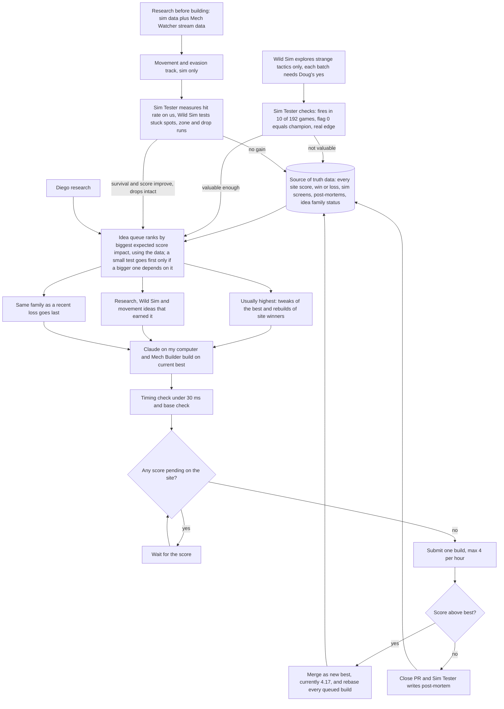

# Workflow chart (Doug's version, authoritative)

This chart changes only when Doug changes a rule. Each edit notes the rule, with its date and time. Updated Sat Nov 21 3:06 PM ET: queue ranking is now by biggest expected impact (Doug 2:54 PM), research comes before building (Doug 2:40 PM), and the best score is now 4.17.

