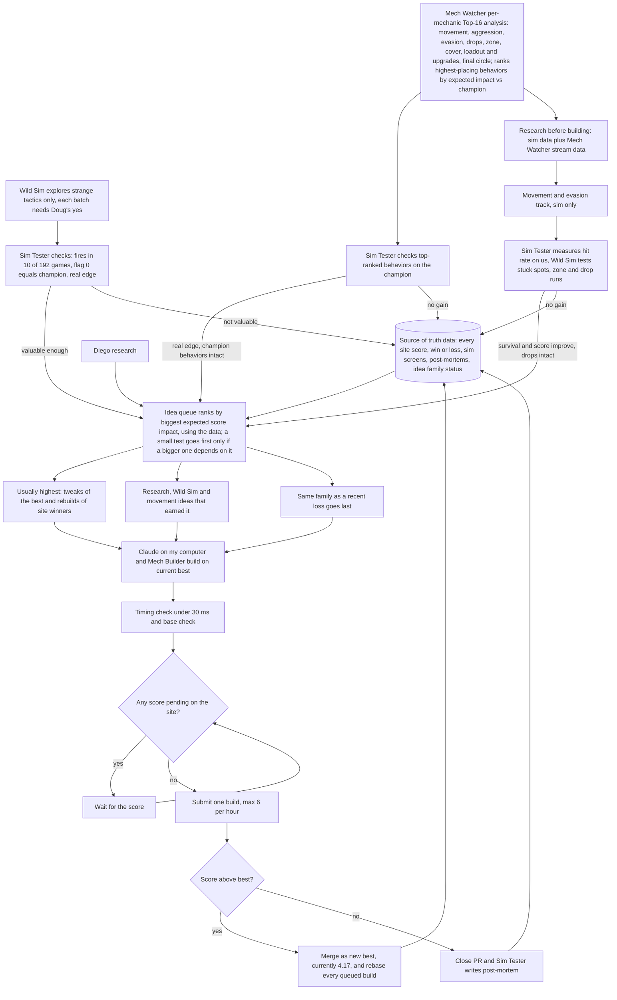

# Workflow chart (Doug's version, authoritative)

**LOCKED: confirmed by Doug, Sat Nov 21 3:09 PM ET.** The process runs exactly as drawn here. Any change to the flow or rules needs Doug's explicit confirmation first; no agent may change it on its own.

This chart changes only when Doug changes a rule. Each edit notes the rule, with its date and time. Updated Sat Nov 21 3:06 PM ET: queue ranking is now by biggest expected impact (Doug 2:54 PM), research comes before building (Doug 2:40 PM), and the best score is now 4.17. Updated Sat Nov 21 3:27 PM ET (Doug confirmed): added the per-mechanic Top-16 Watcher analysis (coord/data/watcher/), which ranks the highest-placing behaviors by expected impact; they go through the sim before the queue and also feed the research step. Updated Sat Nov 21 4:10 PM ET (Doug confirmed): the site now allows 6 tests per hour, and we use all 6. Updated Sat Nov 21 5:41 PM ET (Doug confirmed, overhaul): (1) no site test without Mech Sim Tester's COMPLETE paired screen on both 2000+3000 and 4000+5000 on the exact SHA; a fast 96-game run is not a screen; (2) the 10-minute routine is the ONLY submitter, and it reconciles site receipts against coord/data before each submit; (3) a previously tested idea qualifies again only if the sim shows the new champion changes where or how often it fires, and it ranks below new ideas (the B104/B107 case); (4) keep a reserve of two fully screened builds plus one researched idea; Diego's Claude is backup builder when the Claude on Grok's computer hits its usage limit. Updated Sat Nov 21 6:46 PM ET (Doug confirmed D1, D2, D3, D6): one JSON record per idea at coord/data/ideas/<id>.json is the canonical record; record-first intake (the record exists before a build starts, chat is only notification); one change per test (PR template and eligibility checker, unless Doug writes a waiver); the 10-minute loop regenerates coord/data/pipeline_view.json each tick and Grok refreshes the pipeline Page. Updated Sat Nov 21 7:00 PM ET (Doug confirmed): pre-build 3-4 ahead, each still needs the full paired screen before it's tested; rebuild on top of any new winner.



- Doug 7:16 PM ET: stall rule narrowed (see WORKFLOW.md, "stall rule"); other vetoes unchanged.

- Doug 7:35 PM ET: full paired screens run on the #133 faster sim (identical results, about 2.6x faster).

- Doug 7:55 PM ET: drop-arrival veto judged by set totals; a ~1.3 s earlier death at the same place is not "worse" under stall clause (b).

- Doug 8:32-8:33 PM ET: Diego's Mac is a second screening station (after the P-D-014 trees work), once it matches Sim Tester's P29 screen exactly. The coordinator assigns each build to one station.
- Doug 8:43-8:44 PM ET: when no fully screened build is ready and a slot is free, a build that beat the 15-champions sim on both seed sets with no extra early deaths (and passes the basic checks and the novelty check) may go to the site. A full-screen VETO still blocks it.
- Doug 8:45-8:46 PM ET: the 15-champions sim runs on every current build from now on; the spare-slot auto-submit stays off until it proves out and Doug turns it on.
- Doug 8:58 PM ET: official screens switch to trees ON once the sim's trees and buildings are checked against the real site map (Mech Watcher footage) and the champion baseline is re-run with trees.

- Doug 9:47 PM ET (Sat Nov 21, confirmed): near-miss pathway added as a separate section below. The chart and bullets above are unchanged. All existing simulation thresholds, vetoes, required screens, the 6-per-hour limit, the loop as the only submitter, and champion preservation stay in force. No new agents.

## Near-miss pathway (Doug confirmed Sat Nov 21 9:47 PM ET)

This is a **separate pathway**, not a replacement for the official process drawn above. Simulation grading thresholds, rejection rules (vetoes), required screens, the 6-per-hour site-test limit, the 10-minute loop as the only submitter, champion preservation (keep only if the official score is strictly above the current champion), and the primary READY submission path are unchanged. No new agents.

**When (spare-slot formula, run at every 10-minute check):**

`spare = (6 - U) - (R + 1)`

- `U` is official site tests used in the last 60 minutes.
- `R` is how many builds are expected to finish the Builder checklist (about 40 minutes) and the full paired screen (about 10 minutes) before the oldest used slot frees.
- The `+1` is a reserved extra spot for an unexpected passing build.
- If spare is 1 or more, no official score is pending, and no normal READY build is waiting, the loop may submit the top eligible near miss, one at a time. Normal READY builds always go first.

**What (ranked pool, at most 5):** recorded in `coord/data/near_miss_ranking.md`. Rank by evidence: closeness to existing simulation thresholds, real behavior change, whether champion strengths are kept, absence of serious regressions, and novelty versus past site tests. Never rank by sim score alone, and never use fabricated estimates.

A candidate must be all of the following:

- a valid single-flag build that has never been site-tested and is not equivalent to an already-tested behavior
- contain the current champion (P34, main `8c130ad`)
- eqdrive byte-identical with the flag off
- `check.py` max under 30 ms
- archive under 15,000,000 bytes
- flag-ON head
- a full paired trees-on screen on 2000+3000 and 4000+5000 versus the current champion
- activation of at least about 10 of 192 games
- fail **exactly one** veto (never a crash, never a lower overall mean on both seed sets)

Old trees-off rejects need a trees-on rerun first. A build that does not already contain the current champion must be rebased onto current main before that screen.

**Result handling:** log the submission as a "near-miss data test" with the veto it failed. It becomes champion only if the official score is strictly above the current best. A win is recorded as a confirmed sim false negative.

```mermaid
flowchart TD
    NM[Near-miss pool, max 5, ranked by evidence] --> SP{spare = (6 - U) - (R + 1) at least 1, and no score pending, and no READY build waiting?}
    SP -- no --> WAIT[Wait; the normal path above is unchanged]
    SP -- yes --> SUB[Loop submits the top eligible near miss, one at a time, logged as a near-miss data test]
    SUB --> SC{Official score strictly above champion?}
    SC -- yes --> WIN[New champion; record a confirmed sim false negative]
    SC -- no --> LOG[Champion unchanged; log the official result]
```

## Speed-ups (Doug confirmed Sat Nov 21 10:06 PM ET)
1. Second screening station: Diego's Mac (P-D-015) screens trees-on in parallel with Mech Sim Tester once its match check reproduces the champion baseline exactly. Same screen rules; Sim Tester stays primary.
2. Fires-often-enough check (log-only Step A, 10/192 on both sets) before every full build of a new idea (coord/BUILD_CHECKLIST.md).
3. Spare tests go to the top eligible near miss under the 9:47 PM ET near-miss pathway, every 10-minute check, without waiting.


## Second screening station (Doug confirmed Sat Nov 21 10:28 PM ET)
"Use Diego's Mac for screens with the build and champion on the same machine, cross-checking the first two builds on both stations." A Mac screen counts only if the champion baseline was also run on the Mac (same sim 4b8663e). The first two builds (P43, P35b) are screened on both stations; the Mac joins the rotation only if every veto decision matches. Otherwise it stays info-only and Doug decides.
