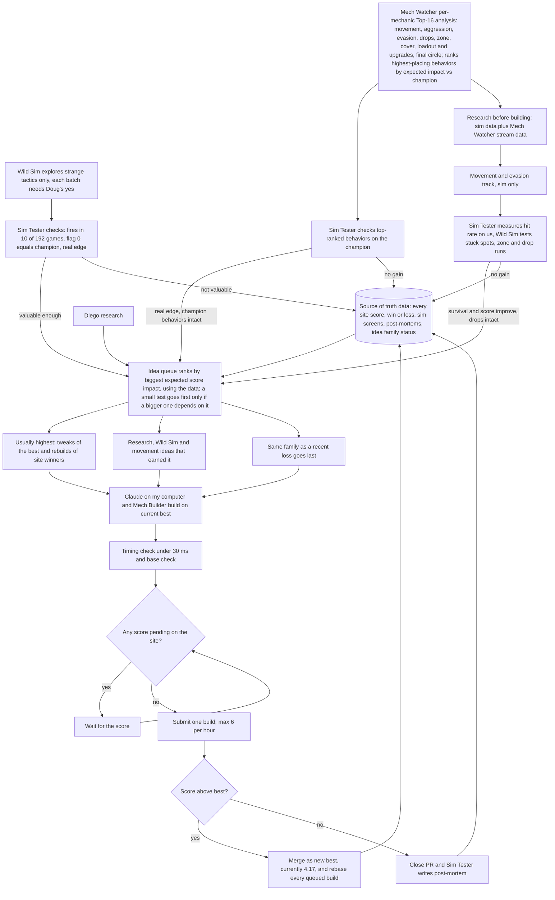

# Workflow chart (Doug's version, authoritative)

**LOCKED: confirmed by Doug, Sat Nov 21 3:09 PM ET.** The process runs exactly as drawn here. Any change to the flow or rules needs Doug's explicit confirmation first; no agent may change it on its own.

This chart changes only when Doug changes a rule. Each edit notes the rule, with its date and time. Updated Sat Nov 21 3:06 PM ET: queue ranking is now by biggest expected impact (Doug 2:54 PM), research comes before building (Doug 2:40 PM), and the best score is now 4.17. Updated Sat Nov 21 3:27 PM ET (Doug confirmed): added the per-mechanic Top-16 Watcher analysis (coord/data/watcher/), which ranks the highest-placing behaviors by expected impact; they go through the sim before the queue and also feed the research step. Updated Sat Nov 21 4:10 PM ET (Doug confirmed): the site now allows 6 tests per hour, and we use all 6. Updated Sat Nov 21 5:41 PM ET (Doug confirmed, overhaul): (1) no site test without Mech Sim Tester's COMPLETE paired screen on both 2000+3000 and 4000+5000 on the exact SHA; a fast 96-game run is not a screen; (2) the 10-minute routine is the ONLY submitter, and it reconciles site receipts against coord/data before each submit; (3) a previously tested idea qualifies again only if the sim shows the new champion changes where or how often it fires, and it ranks below new ideas (the B104/B107 case); (4) keep a reserve of two fully screened builds plus one researched idea; Diego's Claude is backup builder when the Claude on Grok's computer hits its usage limit. Updated Sat Nov 21 6:46 PM ET (Doug confirmed D1, D2, D3, D6): one JSON record per idea at coord/data/ideas/<id>.json is the canonical record; record-first intake (the record exists before a build starts, chat is only notification); one change per test (PR template and eligibility checker, unless Doug writes a waiver); the 10-minute loop regenerates coord/data/pipeline_view.json each tick and Grok refreshes the pipeline Page. Updated Sat Nov 21 7:00 PM ET (Doug confirmed): pre-build 3-4 ahead, each still needs the full paired screen before it's tested; rebuild on top of any new winner.

- Doug 7:16 PM ET: stall rule narrowed (see WORKFLOW.md, "stall rule"); other vetoes unchanged.

- Doug 7:35 PM ET: full paired screens run on the #133 faster sim (identical results, about 2.6x faster).

- Doug 7:55 PM ET: drop-arrival veto judged by set totals; a ~1.3 s earlier death at the same place is not "worse" under stall clause (b).

- Doug 8:32-8:33 PM ET: Diego's Mac is a second screening station (after the P-D-014 trees work), once it matches Sim Tester's P29 screen exactly. The coordinator assigns each build to one station.
