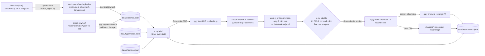

# Pipeline: evidence, experiment memory, Codex review

The smallest version that keeps the existing loop (Grok coordinates every 15 min, Grok's Claude codes, Grok submits, watcher records, Diego researches) and adds one queryable memory. Plain JSONL files, stdlib Python only (3.9+), no database. Excluded from the Docker build (`.dockerignore`).



## Evidence classes (kept separate)
| class | ID | where from |
|---|---|---|
| `observed` | `EV-W-O-<seed>-<mech>` | one mech in one watched match (box keeps all; repo keeps winners) |
| `derived` | `EV-W-D-showdown-<metric>` | mean/median/n per placement group over complete top-16 showdowns (upserted each ingest) |
| `research_claim` | `EV-R-NNNN` | Diego / handoff claims, always `verification: unverified` until tested |
| `hypothesis` | `HYP-NNN` (hypotheses.jsonl) | proposed single changes with status `untested / failed / supported / inconclusive / adopted` |
| `validated` | `EV-V-NNNN` | a practice score delta (48 fixed seeds; valid for practice only) |

Watcher data is top-16 exhibition FFA, **not** practice vs the house squad. Official results are aggregate only: every experiment carries `evaluation.per_match_data = "none"` (**NO PER-MATCH OFFICIAL DATA**) unless the site actually shows per-match results. Failure classes (Diego's taxonomy: NAV_COLLISION, NAV_STUCK, NAV_BAD_ROUTE, ZONE_LATE, MULTI_ENEMY_TRAP, COVER_FAILURE, REGEN_RESET, OVER_AGGRESSION, UNDER_AGGRESSION, AIM_WEAPON, RESOURCE_TRAP, COMPUTE_FAILURE, UNKNOWN) are stored as suspicions with a confidence.

## Contracts (`schemas/`, regenerate with `python3 pipeline/gen_schemas.py`)
`watcher_event`, `research_finding`, `strategy_hypothesis`, `implementation_task`, `codex_review` (+ `codex_output`, what Codex must return), `experiment_result`, `champion_state`, `evidence_record`. `q.py validate` checks every stored record.

## Grok's decision logic (`q.py brief`)
1. Champion, gap to 6.00, slots used in the rolling 60 min.
2. In-flight candidates (kit / codex / submission state).
3. Last N scored experiments with delta and lesson; adopted / failed hypotheses.
4. Untested hypotheses ranked by Diego's formula (ordering only, factors printed): `priority = impact × evidence_confidence × recurrence / (effort + test_burden + regression_risk)`, with novelty, targeted failure classes, in-progress branch and "similar tested" warnings.
5. Watcher winner-vs-bottom metrics, latest research claims, validated count, contradictions (failed hypotheses that had supporting evidence, contradicting evidence IDs).
Grok picks ONE; `q.py task HYP-x` prints the Claude prompt (parent commit, single hypothesis, observed failure, mechanism, predicted metric direction, rollback condition, evidence, related experiments, known failures, constraints, acceptance).

Promotion: `score > champion.score + min_gain` (config, 0.0; practice is deterministic). Equal = tie, lower = loss; champion preserved; record always kept. `add-exp` refuses a hypothesis that was already tested unless `--repeat-reason` is given, and refuses a commit that was already scored.

## Operating commands (run from the repo root)
```bash
# each tick
/workspace/watch/update.sh                     # findings.md + box pipeline records (best effort)
python3 pipeline/q.py ingest-watch             # upsert watcher summary into pipeline/data
python3 pipeline/q.py ingest-research          # after merging a Diego intake PR
python3 pipeline/q.py brief
python3 pipeline/q.py tested <keyword>
python3 pipeline/q.py task HYP-010 > /tmp/task.txt   # paste into claude -p

# candidate lifecycle
python3 pipeline/q.py add-exp --hyp HYP-010 --commit <sha> --branch <b> --pr <n> [--repeat-reason "..."]
python3 pipeline/q.py set-check EXP-00NN pass --p99 0.9        # or fail (never consumes a slot)
bash    pipeline/codex_review.sh <champion_sha> <sha> HYP-010 EXP-00NN   # exit 0 ok/fallback, 2 block, 3 required+unavailable
python3 pipeline/q.py eligible EXP-00NN                         # exit 1 + reasons if not
python3 pipeline/q.py mark-submitted EXP-00NN --submission-id BB-XXXXXXXX
python3 pipeline/q.py record-score EXP-00NN --score 2.51 --lesson "..." --next "..." [--failure NAV_STUCK:0.4]
python3 pipeline/q.py promote EXP-00NN --merge-commit <sha>     # refuses unless score beats champion

# checks
python3 pipeline/q.py validate
python3 pipeline/tests/test_pipeline.py
bash    pipeline/e2e_dryrun.sh                                  # scratch copy; synthetic parts labeled
```
Only Grok writes `pipeline/data/` (single coordinator; writes are also flock-protected). Commit data changes with the tick's log commit.

## Codex
Codex CLI 0.171.0 is installed on the box (`~/.local/bin/codex`, npm `@openai/codex`) but **not logged in**, so reviews are recorded as `status: unavailable` and the loop continues under `codex_required: false`. To enable, Doug runs one of these on the box (never commit tokens): `codex login` (ChatGPT plan; `codex login --device-auth` for a headless box), or `printenv OPENAI_API_KEY | codex login --with-api-key`. The review runs `codex exec --sandbox read-only --ephemeral --output-schema schemas/codex_output.json` in a throwaway detached worktree, so it cannot change Claude's candidate. Any critical finding blocks, whatever verdict the model returned. Challenger mode (Codex implementing in its own worktree) is not built.
